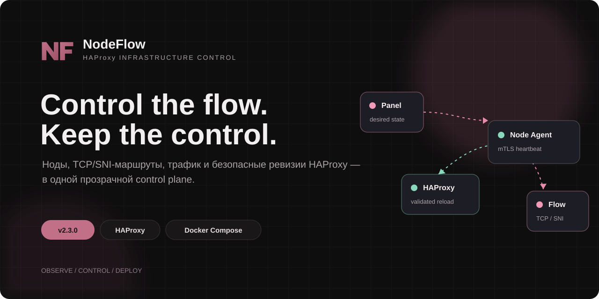
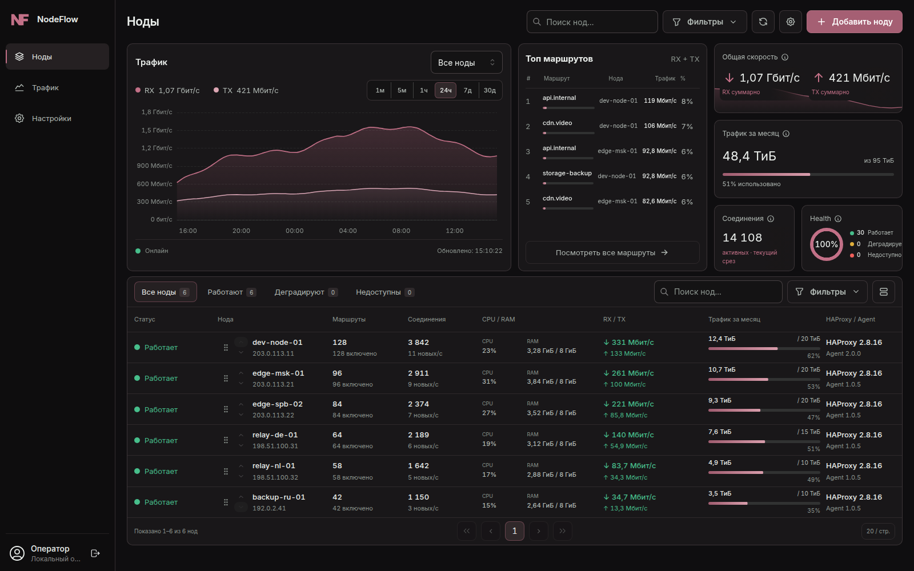
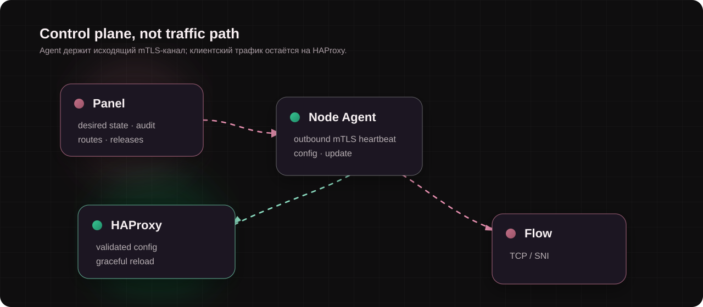
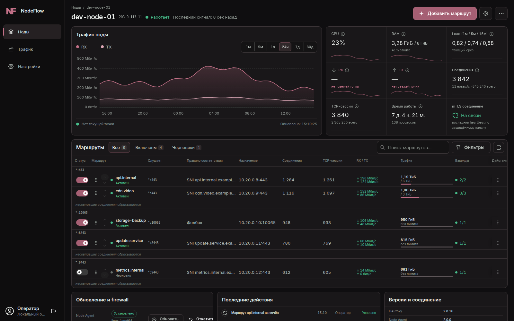
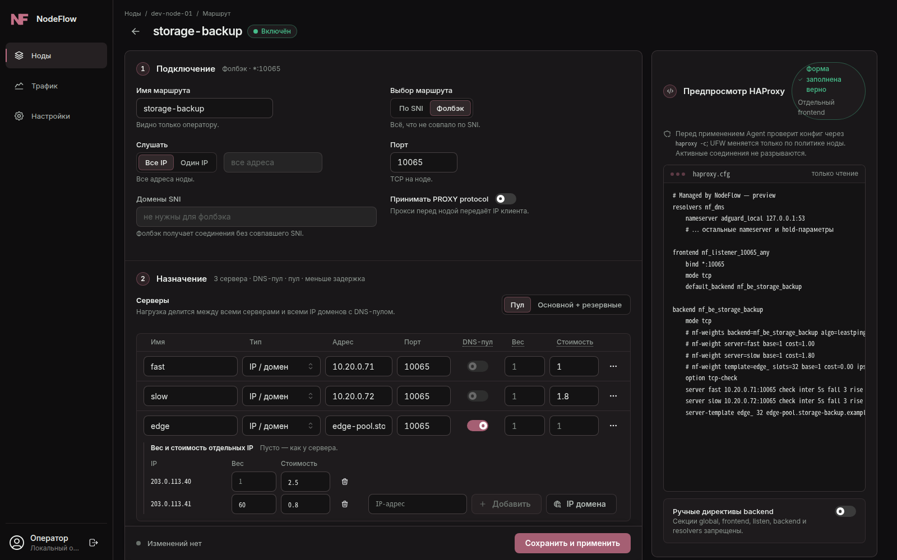
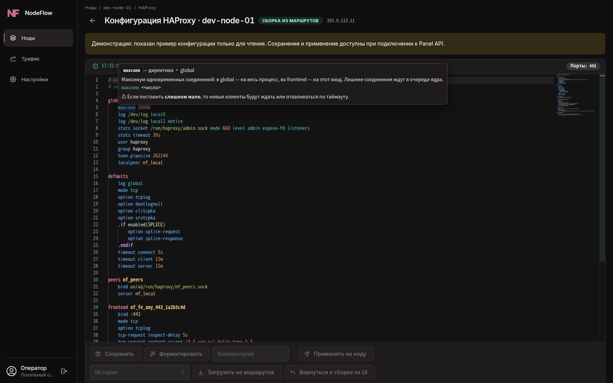
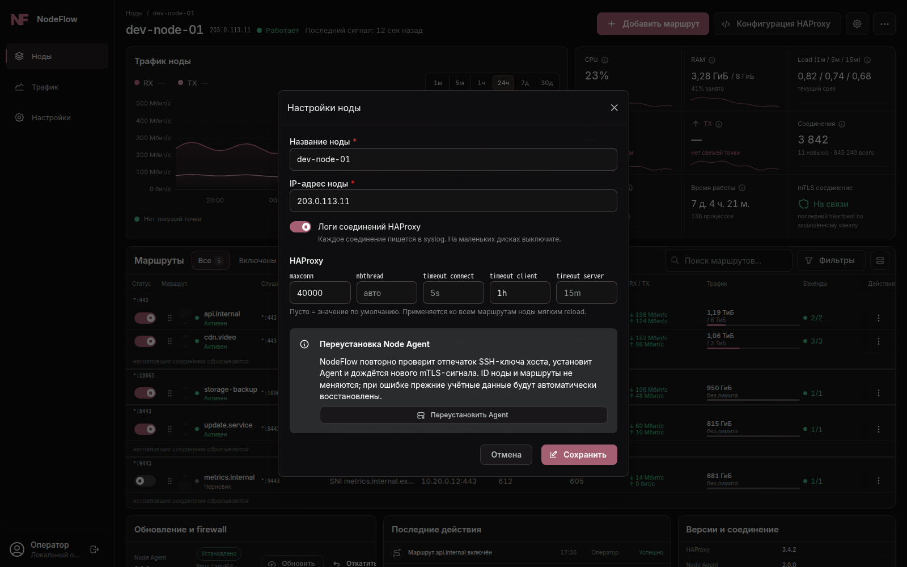
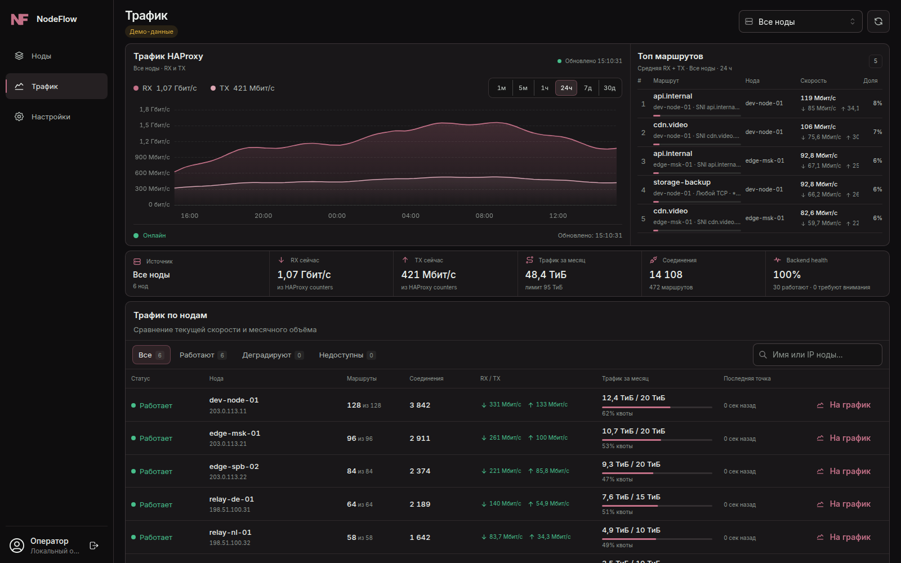
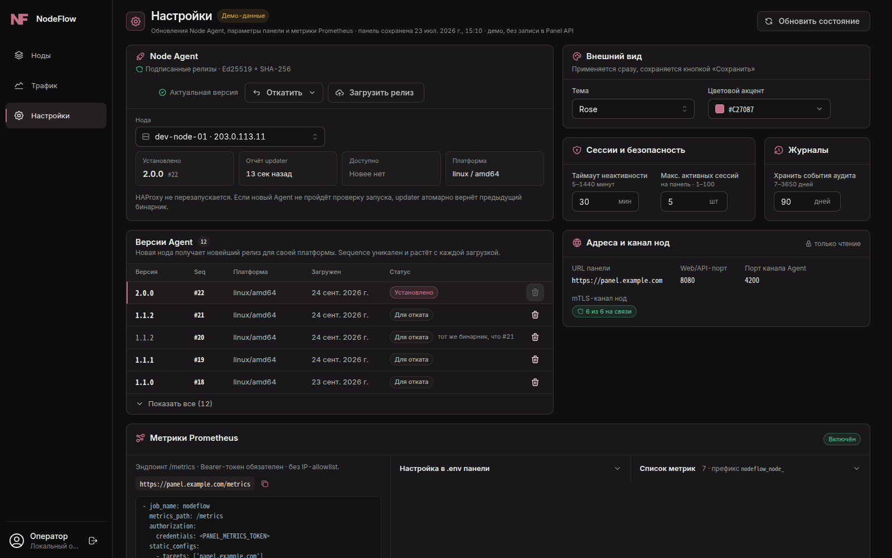

**English** | [Русский](README.md)

<p align="center">
  
</p>

<p align="center">
  <a href="#quick-install">Install</a> ·
  <a href="#upgrading-from-10x">Upgrade</a> ·
  <a href="#screenshots">Screenshots</a> ·
  <a href="docs/releases/2.2.0.en.md">What's new in 2.2.0</a> ·
  <a href="../../issues">Issues</a> ·
  <a href="#support-the-project">Support</a>
</p>

NodeFlow is a control panel for a fleet of HAProxy nodes doing TCP and SNI routing. The Panel (Go API + React UI + PostgreSQL) stores routes and immutable configuration revisions, while a Node Agent on each node connects to the Panel over mTLS on its own, validates and applies the HAProxy config, reports metrics and updates itself from signed releases. No manual editing of `haproxy.cfg` and no inbound access to nodes is needed for management.



## Features

- **SNI routing and fallback.** Shared listeners per port, multiple SNI names per route, a "Fallback" route for everything that did not match; IP, domain and Unix socket backends.
- **Multiple servers and DNS pools.** Up to 16 servers per route in "Pool" and "Primary + backups" modes; a domain can act as a DNS pool (all A/AAAA addresses, unreachable ones excluded), with separate weights for pool IPs.
- **Load balancing.** `roundrobin`, `static-rr`, `random`, `leastconn` and `leastping` ("Lowest latency"). Weights per server and per DNS pool IP, plus a cost (latency multiplier) for `leastping`; tolerance: servers with similar load or latency share clients by weight, and the Agent sets weights on the fly through the runtime API, without a reload.
- **Client stickiness.** IP hash (consistent or map-based, IPv6 grouped by prefix) or a table with TTL that survives reloads; the "Auto" size is derived from the node's RAM.
- **PROXY protocol.** Accepted from trusted IPs, subnets and domains (the Agent resolves them and updates the ACL without a reload), or "from everyone"; health checks with a PROXY header.
- **Rate limiting.** Upload/download limits per client IP — via HAProxy filters or in the kernel via nftables (`shaper_mode=kernel`), without losing splice.
- **Performance.** Zero-copy splice in both directions; the Agent raises `fs.pipe-max-size`, and the Panel renders 1 MiB buffers instead of 256 KiB.
- **Quotas and traffic accounting.** Monthly traffic for nodes, backends and routes; per-route quotas.
- **Safe apply.** Desired/actual revisions, a full `haproxy -c` check before the config is replaced, graceful reload with rollback.
- **`haproxy.cfg` editor.** Node page → "HAProxy configuration": Monaco with highlighting and autocompletion, directive hints on hover, live validation (unknown directives and options, stray characters, ports, backend references), a diff before applying and revision history. A `haproxy -c` error from the node is shown as text with links to lines; one button returns to the config generated from routes.
- **Node HAProxy settings.** `maxconn`, `nbthread` and the `connect`/`client`/`server` timeouts live in the node settings and apply to all routes via a reload without dropping connections; connection logs can be turned off there too.
- **Prometheus `/metrics`** in the Panel: node and route state, connections, traffic, revision sync (bearer token, CIDR allowlist).
- **Signed Agent updates.** Ed25519 + SHA-256, a monotonic sequence, atomic activation and automatic rollback.
- **mTLS.** A separate client certificate per node, rotation and staged renewal; the Agent's local API is reachable from loopback only.
- **UFW.** Listener port rules are built from the applied revision; other rules are left untouched.

## Architecture



The Agent opens the connection to the Panel itself: it receives revisions and commands and sends heartbeats with metrics. SSH is needed once — for the initial Agent installation.

## Requirements

- **Panel:** Ubuntu 22.04+/Debian 12+ (amd64 or arm64), 2 vCPU, 2 GB RAM, 15 GB disk, a domain with an A/AAAA record pointing to the server, open `80`, `443` and `4200/tcp`. The installer sets up Docker Engine with Compose and Caddy itself.
- **Nodes:** Linux amd64 or arm64 with systemd and HAProxy 3.x. Automatic installation from the Panel supports Ubuntu 24.04 (noble) and 26.04 (resolute) — the Panel installs HAProxy 3.4 from the official HAProxy Performance repository and does not downgrade a newer installed HAProxy — and Debian: if HAProxy is not present, the distribution's `haproxy` package is installed (on Debian 12 that is 2.6, so install HAProxy 3.x beforehand). nftables is needed for in-kernel rate limiting. SSH access as root or as a user with sudo, by password or key.

## Quick install

### Panel

On a clean server:

```bash
curl -fsSL https://raw.githubusercontent.com/NodeFlow-dev/nodeflow/main/install.sh | sudo sh
```

The installer will:

1. ask for the domain and check that its DNS points to this server;
2. offer an access mode: Caddy cookie gate (an activation link sets a secure cookie) or none — the Panel admin token is required either way;
3. install Docker and **Caddy** — Caddy obtains a Let's Encrypt certificate itself and proxies HTTPS to the Panel, which listens only on `127.0.0.1:8080`;
4. download the install kit of the latest release, verify it against the SHA-256 that GitHub publishes for every release asset, take `compose.release.yaml` from it, and generate `.env`, the CA, the mTLS certificate and the update signing key in `/opt/nodeflow`;
5. run `docker compose pull && docker compose up -d` with the `ghcr.io/nodeflow-dev/nodeflow-panel:2.2.0` image — nothing is built on the server, and the image applies database migrations itself;
6. publish signed Node Agent releases (amd64 and arm64) and save the login credentials to `~/nodeflow-credentials.txt` (mode `0600`).

The installer does not change the firewall. For unattended automation, pass `NODEFLOW_DOMAIN`, `NODEFLOW_AUTH_MODE=cookie|none` and, if needed, `NODEFLOW_VERSION=2.2.0` (defaults to the latest release):

```bash
curl -fsSL https://raw.githubusercontent.com/NodeFlow-dev/nodeflow/main/install.sh \
  | sudo NODEFLOW_DOMAIN=panel.example.com NODEFLOW_AUTH_MODE=cookie sh
```

The installer is also included in the install kit (`NodeFlow-Panel-<version>-Agent-<version>-install-kit.tar.gz` in the release assets): unpack it and run `sudo ./install.sh` — then `compose.release.yaml` is taken from the kit, and only the Agent binaries for publishing to the Panel are downloaded from GitHub.

The release assets are exactly three files: the install kit (installers, `compose.release.yaml`, a `.env` template, PKI and node scripts, the Agent systemd unit, instructions) and the `nodeflow-node-agent-<version>-linux-amd64` / `-linux-arm64` binaries. The Panel ships only as the `ghcr.io/nodeflow-dev/nodeflow-panel` image. There is no separate `SHA256SUMS`: the installers check every downloaded file against the SHA-256 that GitHub publishes for the asset (the `digest` field in the release API) and abort on a mismatch or a missing digest.

### Nodes

In the Panel: **Nodes → Add node** → IP, SSH port, user and password or key → verify the host fingerprint → **"Install Node Agent"**. The Panel connects over SSH once and installs the signed Agent, the updater and the node's mTLS certificate; from then on the node is managed only through the outbound mTLS channel on `4200/tcp`.

For recovery without the Panel there is `install-node.sh`: it downloads the Agent for the node's architecture from the latest release (or from `NODEFLOW_VERSION`) and verifies it against the asset's SHA-256 from the GitHub API; the systemd unit is embedded in the script. It requires `curl`, `jq` or `python3`, and an installed HAProxy:

```bash
curl -fsSL https://raw.githubusercontent.com/NodeFlow-dev/nodeflow/main/scripts/install-node.sh -o install-node.sh
sudo NODE_AGENT_TOKEN=<token> bash install-node.sh
```

The same script is in the install kit: `scripts/install-node.sh`.

### Manual installation with Docker Compose

Run the commands as root (`sudo -i`): the `/opt/nodeflow` directory is closed to other users.

```bash
v=2.2.0
kit=NodeFlow-Panel-$v-Agent-$v-install-kit
curl -fsSLO "https://github.com/NodeFlow-dev/nodeflow/releases/download/v$v/$kit.tar.gz"
# compare with the asset digest on the release page or in the API:
curl -fsSL "https://api.github.com/repos/NodeFlow-dev/nodeflow/releases/tags/v$v" \
  | jq -r --arg n "$kit.tar.gz" '.assets[] | select(.name == $n) | .digest'
sha256sum "$kit.tar.gz"
tar -xzf "$kit.tar.gz" && cd "$kit" && sha256sum -c SHA256SUMS
install -d -m 0750 /opt/nodeflow
install -m 0644 compose.release.yaml /opt/nodeflow/compose.yaml
install -m 0600 nodeflow.env.example /opt/nodeflow/.env   # fill in secrets and domain
install -d /opt/nodeflow/scripts && install -m 0755 scripts/init-*.sh /opt/nodeflow/scripts/
/opt/nodeflow/scripts/init-mtls-pki.sh panel.example.com /opt/nodeflow   # CA, mTLS, signing key
cd /opt/nodeflow && docker compose pull && docker compose up -d
curl -fsS http://127.0.0.1:8080/healthz
```

The Panel needs an HTTPS reverse proxy in front of it: ready-made Caddy and Nginx examples are in [`docs/install/reverse-proxy`](docs/install/reverse-proxy). Port `4200` is not proxied: nodes connect to it directly.

## Upgrading from 1.0.x

Run the same installer again on the Panel server:

```bash
curl -fsSL https://raw.githubusercontent.com/NodeFlow-dev/nodeflow/main/install.sh | sudo sh
```

When it finds `/opt/nodeflow/.env`, it acts as an upgrader: it makes a `pg_dump` and a configuration archive in `/var/backups/nodeflow/`, keeps `.env`, `tls/`, `pki/` and the Caddy snippet `/etc/caddy/conf.d/nodeflow-panel.caddy`, moves the installation from a source build to the ghcr.io image, runs migrations and checks that the Panel responds with the new version. On failure the previous `compose.yaml` and `.env` are restored; the database dump is kept (migrations are not rolled back automatically).

Then, in **Settings → Node Agent**, update the nodes to 2.2.0 — the updater replaces the Agent atomically and rolls it back if it fails to start. Self-update does not change the systemd unit, so on nodes installed by 1.0.x versions add permission to tune kernel pipe buffers once (without it splice stays at 256 KiB) — or reinstall the Agent from the node menu:

```bash
sudo install -d /etc/systemd/system/nodeflow-node-agent.service.d
printf '[Service]\nReadWritePaths=-/etc/sysctl.d -/proc/sys/fs/pipe-max-size -/proc/sys/fs/pipe-user-pages-soft\n' \
  | sudo tee /etc/systemd/system/nodeflow-node-agent.service.d/20-kernel-pipes.conf
sudo systemctl daemon-reload && sudo systemctl restart nodeflow-node-agent
```

Details, behaviour changes and the list of migrations are in the [2.0.0 release notes](docs/releases/2.0.0.md) (Russian).

## Screenshots

### Node card



### Route editor with HAProxy preview



### haproxy.cfg editor with hints and validation



### Node HAProxy settings



### Traffic and top routes



### Settings: Node Agent releases, Panel and Prometheus



## Building from source

Requires Go 1.25+ and Node.js 22+.

```bash
git clone https://github.com/NodeFlow-dev/nodeflow.git && cd nodeflow
(cd frontend && npm ci && npm run build)
./scripts/build-panel.sh                  # panel-api with embedded UI
go build -trimpath -o node-agent ./cmd/node-agent
go build -trimpath -o node-updater ./cmd/node-updater
go test ./...
```

Local setup: `cp .env.example .env`, fill in the secrets and run `docker compose up -d --build` — the root `compose.yaml` builds the image from `Dockerfile.panel`. PostgreSQL integration tests are enabled with the `NODEFLOW_TEST_DATABASE_URL` variable.

## Documentation

- Release notes: [2.2.0](docs/releases/2.2.0.en.md); in Russian: [2.1.0](docs/releases/2.1.0.md), [2.0.1](docs/releases/2.0.1.md), [2.0.0](docs/releases/2.0.0.md), [CHANGELOG](CHANGELOG.md)
- [Panel API](docs/api-contract.md) (Russian)
- [Node HAProxy settings and config editor](docs/features/haproxy-configuration.md) (Russian)
- [Architecture](docs/architecture.md) (Russian)
- [Initial node installation](docs/bootstrap-flow.md) (Russian)
- [Agent self-update](docs/node-self-update.md) (Russian)
- [Manual installation](docs/install/README-PANEL.txt) (Russian)

## Security

- The Node Agent is not exposed to the internet: its local API accepts only loopback traffic, and management goes over the outbound mTLS channel.
- Each node gets its own client certificate.
- Agent releases are verified by Ed25519 signature, SHA-256, platform and version sequence.
- By default the Panel listens only on `127.0.0.1`; exposing HTTP externally requires an explicit `ALLOW_INSECURE_HTTP=true`.
- Privileged actions are written to the audit log.

Report vulnerabilities as described in [SECURITY.md](SECURITY.md), not through public Issues.

## Feedback

Bug reports, ideas and installation questions go to [Issues](../../issues). Include the Panel/Agent versions, the node's OS and HAProxy version, steps to reproduce and anonymized logs — without tokens, keys, certificates or client IP addresses. Pull request rules are in [CONTRIBUTING.md](CONTRIBUTING.md).

## Support the project

Support matters a lot for keeping NodeFlow updates coming.

[Tribute](https://web.tribute.tg/d/Pat)

Tron: `TNUe93tFxeHj4avBY8s3NWzjaiyZfPWD9T`

## License

© 2026 NodeFlow. All rights reserved. The source code is available for review, for self-hosting by NodeFlow users and for contributing to this repository. Redistribution, including of modified versions, and commercial use of the code require written permission from the copyright holder. Full text in [LICENSE](LICENSE).
